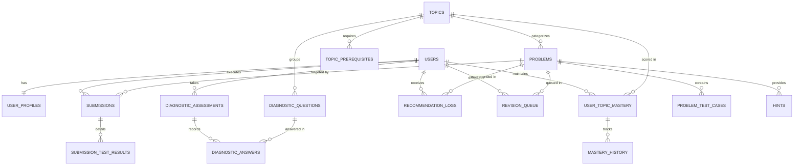

# CodeAdapt AI — Database Schema Specification

**Document Status:** Production DDL & ERD  
**Database Engine:** PostgreSQL 15+  
**Architecture:** Relational with JSONB extensions for test cases and telemetry  

---

## 1. Entity-Relationship Diagram (ERD)



---

## 2. PostgreSQL DDL Implementation

```sql
-- ============================================================================
-- ENUM TYPES
-- ============================================================================

CREATE TYPE user_role_enum AS ENUM ('STUDENT', 'ADMIN', 'CONTENT_AUTHOR');
CREATE TYPE difficulty_level_enum AS ENUM ('EASY', 'MEDIUM', 'HARD');
CREATE TYPE submission_status_enum AS ENUM ('QUEUED', 'RUNNING', 'COMPLETED', 'FAILED');
CREATE TYPE verdict_enum AS ENUM (
    'ACCEPTED',
    'WRONG_ANSWER',
    'TIME_LIMIT_EXCEEDED',
    'MEMORY_LIMIT_EXCEEDED',
    'RUNTIME_ERROR',
    'SYNTAX_ERROR',
    'INTERNAL_ERROR'
);
CREATE TYPE hint_tier_enum AS ENUM ('CONCEPTUAL', 'PATTERN', 'PSEUDOCODE');
CREATE TYPE assessment_status_enum AS ENUM ('IN_PROGRESS', 'COMPLETED', 'ABANDONED');
CREATE TYPE revision_status_enum AS ENUM ('PENDING', 'COMPLETED', 'DISMISSED');

-- ============================================================================
-- 1. AUTH & USER TABLES
-- ============================================================================

CREATE TABLE users (
    id UUID PRIMARY KEY DEFAULT gen_random_uuid(),
    email VARCHAR(255) NOT NULL UNIQUE,
    password_hash VARCHAR(255) NOT NULL,
    role user_role_enum NOT NULL DEFAULT 'STUDENT',
    is_active BOOLEAN NOT NULL DEFAULT TRUE,
    created_at TIMESTAMPTZ NOT NULL DEFAULT CURRENT_TIMESTAMP,
    updated_at TIMESTAMPTZ NOT NULL DEFAULT CURRENT_TIMESTAMP
);

CREATE TABLE user_profiles (
    id UUID PRIMARY KEY DEFAULT gen_random_uuid(),
    user_id UUID NOT NULL UNIQUE REFERENCES users(id) ON DELETE CASCADE,
    display_name VARCHAR(100) NOT NULL,
    preferred_language VARCHAR(30) NOT NULL DEFAULT 'python',
    onboarding_completed BOOLEAN NOT NULL DEFAULT FALSE,
    diagnostic_completed BOOLEAN NOT NULL DEFAULT FALSE,
    streak_days INT NOT NULL DEFAULT 0,
    last_active_at TIMESTAMPTZ,
    created_at TIMESTAMPTZ NOT NULL DEFAULT CURRENT_TIMESTAMP,
    updated_at TIMESTAMPTZ NOT NULL DEFAULT CURRENT_TIMESTAMP
);

-- ============================================================================
-- 2. CURRICULUM, TOPICS & PREREQUISITES
-- ============================================================================

CREATE TABLE topics (
    id UUID PRIMARY KEY DEFAULT gen_random_uuid(),
    name VARCHAR(100) NOT NULL UNIQUE,
    slug VARCHAR(100) NOT NULL UNIQUE,
    description TEXT,
    order_index INT NOT NULL DEFAULT 0,
    created_at TIMESTAMPTZ NOT NULL DEFAULT CURRENT_TIMESTAMP
);

CREATE TABLE topic_prerequisites (
    topic_id UUID NOT NULL REFERENCES topics(id) ON DELETE CASCADE,
    prerequisite_topic_id UUID NOT NULL REFERENCES topics(id) ON DELETE RESTRICT,
    PRIMARY KEY (topic_id, prerequisite_topic_id),
    CHECK (topic_id <> prerequisite_topic_id)
);

-- ============================================================================
-- 3. PROBLEMS & TEST SUITES
-- ============================================================================

CREATE TABLE problems (
    id UUID PRIMARY KEY DEFAULT gen_random_uuid(),
    title VARCHAR(255) NOT NULL,
    slug VARCHAR(255) NOT NULL UNIQUE,
    topic_id UUID NOT NULL REFERENCES topics(id) ON DELETE RESTRICT,
    difficulty difficulty_level_enum NOT NULL,
    description_markdown TEXT NOT NULL,
    starter_code TEXT NOT NULL,
    reference_solution TEXT NOT NULL,
    estimated_time_minutes INT NOT NULL DEFAULT 15,
    cpu_time_limit_ms INT NOT NULL DEFAULT 2000,
    memory_limit_mb INT NOT NULL DEFAULT 64,
    acceptance_rate NUMERIC(5, 2) NOT NULL DEFAULT 0.00,
    total_submissions INT NOT NULL DEFAULT 0,
    total_accepted INT NOT NULL DEFAULT 0,
    is_published BOOLEAN NOT NULL DEFAULT FALSE,
    created_at TIMESTAMPTZ NOT NULL DEFAULT CURRENT_TIMESTAMP,
    updated_at TIMESTAMPTZ NOT NULL DEFAULT CURRENT_TIMESTAMP
);

CREATE TABLE problem_test_cases (
    id UUID PRIMARY KEY DEFAULT gen_random_uuid(),
    problem_id UUID NOT NULL REFERENCES problems(id) ON DELETE CASCADE,
    input_data TEXT NOT NULL,
    expected_output TEXT NOT NULL,
    is_sample BOOLEAN NOT NULL DEFAULT FALSE,
    explanation TEXT,
    order_index INT NOT NULL DEFAULT 0,
    created_at TIMESTAMPTZ NOT NULL DEFAULT CURRENT_TIMESTAMP
);

CREATE TABLE hints (
    id UUID PRIMARY KEY DEFAULT gen_random_uuid(),
    problem_id UUID NOT NULL REFERENCES problems(id) ON DELETE CASCADE,
    tier hint_tier_enum NOT NULL,
    hint_order INT NOT NULL DEFAULT 1,
    content_markdown TEXT NOT NULL,
    created_at TIMESTAMPTZ NOT NULL DEFAULT CURRENT_TIMESTAMP,
    UNIQUE (problem_id, hint_order)
);

-- ============================================================================
-- 4. DIAGNOSTIC ASSESSMENT TABLES
-- ============================================================================

CREATE TABLE diagnostic_assessments (
    id UUID PRIMARY KEY DEFAULT gen_random_uuid(),
    user_id UUID NOT NULL REFERENCES users(id) ON DELETE CASCADE,
    status assessment_status_enum NOT NULL DEFAULT 'IN_PROGRESS',
    started_at TIMESTAMPTZ NOT NULL DEFAULT CURRENT_TIMESTAMP,
    completed_at TIMESTAMPTZ,
    score_summary JSONB,
    created_at TIMESTAMPTZ NOT NULL DEFAULT CURRENT_TIMESTAMP
);

CREATE TABLE diagnostic_questions (
    id UUID PRIMARY KEY DEFAULT gen_random_uuid(),
    topic_id UUID NOT NULL REFERENCES topics(id) ON DELETE CASCADE,
    difficulty difficulty_level_enum NOT NULL,
    question_text TEXT NOT NULL,
    options_json JSONB NOT NULL, -- Array of 4 string options: ["O(1)", "O(n)", ...]
    correct_option_index INT NOT NULL CHECK (correct_option_index >= 0 AND correct_option_index <= 3),
    explanation TEXT,
    created_at TIMESTAMPTZ NOT NULL DEFAULT CURRENT_TIMESTAMP
);

CREATE TABLE diagnostic_answers (
    id UUID PRIMARY KEY DEFAULT gen_random_uuid(),
    assessment_id UUID NOT NULL REFERENCES diagnostic_assessments(id) ON DELETE CASCADE,
    question_id UUID NOT NULL REFERENCES diagnostic_questions(id) ON DELETE CASCADE,
    selected_option_index INT NOT NULL,
    is_correct BOOLEAN NOT NULL,
    time_spent_seconds INT NOT NULL DEFAULT 0,
    created_at TIMESTAMPTZ NOT NULL DEFAULT CURRENT_TIMESTAMP,
    UNIQUE (assessment_id, question_id)
);

-- ============================================================================
-- 5. ADAPTIVE MASTERY & HISTORY
-- ============================================================================

CREATE TABLE user_topic_mastery (
    id UUID PRIMARY KEY DEFAULT gen_random_uuid(),
    user_id UUID NOT NULL REFERENCES users(id) ON DELETE CASCADE,
    topic_id UUID NOT NULL REFERENCES topics(id) ON DELETE CASCADE,
    mastery_score NUMERIC(5, 2) NOT NULL DEFAULT 0.00 CHECK (mastery_score >= 0.00 AND mastery_score <= 100.00),
    is_provisional BOOLEAN NOT NULL DEFAULT TRUE,
    evidence_count INT NOT NULL DEFAULT 0,
    consecutive_successes INT NOT NULL DEFAULT 0,
    consecutive_failures INT NOT NULL DEFAULT 0,
    last_practiced_at TIMESTAMPTZ,
    updated_at TIMESTAMPTZ NOT NULL DEFAULT CURRENT_TIMESTAMP,
    UNIQUE (user_id, topic_id)
);

CREATE TABLE mastery_history (
    id UUID PRIMARY KEY DEFAULT gen_random_uuid(),
    user_id UUID NOT NULL REFERENCES users(id) ON DELETE CASCADE,
    topic_id UUID NOT NULL REFERENCES topics(id) ON DELETE CASCADE,
    previous_score NUMERIC(5, 2) NOT NULL,
    new_score NUMERIC(5, 2) NOT NULL,
    delta NUMERIC(5, 2) GENERATED ALWAYS AS (new_score - previous_score) STORED,
    attempt_score NUMERIC(5, 2) NOT NULL,
    reason VARCHAR(100) NOT NULL,
    created_at TIMESTAMPTZ NOT NULL DEFAULT CURRENT_TIMESTAMP
);

-- ============================================================================
-- 6. CODE SUBMISSIONS & EVALUATION
-- ============================================================================

CREATE TABLE submissions (
    id UUID PRIMARY KEY DEFAULT gen_random_uuid(),
    idempotency_key VARCHAR(64) NOT NULL UNIQUE,
    user_id UUID NOT NULL REFERENCES users(id) ON DELETE CASCADE,
    problem_id UUID NOT NULL REFERENCES problems(id) ON DELETE CASCADE,
    code_content TEXT NOT NULL,
    language VARCHAR(30) NOT NULL DEFAULT 'python',
    status submission_status_enum NOT NULL DEFAULT 'QUEUED',
    verdict verdict_enum,
    runtime_ms INT,
    memory_kb INT,
    passed_tests INT NOT NULL DEFAULT 0,
    total_tests INT NOT NULL DEFAULT 0,
    hints_used_count INT NOT NULL DEFAULT 0,
    created_at TIMESTAMPTZ NOT NULL DEFAULT CURRENT_TIMESTAMP,
    evaluated_at TIMESTAMPTZ
);

CREATE TABLE submission_test_results (
    id UUID PRIMARY KEY DEFAULT gen_random_uuid(),
    submission_id UUID NOT NULL REFERENCES submissions(id) ON DELETE CASCADE,
    test_case_id UUID NOT NULL REFERENCES problem_test_cases(id) ON DELETE CASCADE,
    passed BOOLEAN NOT NULL,
    execution_time_ms INT NOT NULL,
    actual_output TEXT,
    error_message TEXT,
    created_at TIMESTAMPTZ NOT NULL DEFAULT CURRENT_TIMESTAMP
);

-- ============================================================================
-- 7. RECOMMENDATIONS, REVISION & TELEMETRY
-- ============================================================================

CREATE TABLE recommendation_logs (
    id UUID PRIMARY KEY DEFAULT gen_random_uuid(),
    user_id UUID NOT NULL REFERENCES users(id) ON DELETE CASCADE,
    problem_id UUID NOT NULL REFERENCES problems(id) ON DELETE CASCADE,
    topic_id UUID NOT NULL REFERENCES topics(id) ON DELETE CASCADE,
    reason_code VARCHAR(50) NOT NULL,
    explanation TEXT NOT NULL,
    mastery_snapshot NUMERIC(5, 2) NOT NULL,
    was_opened BOOLEAN NOT NULL DEFAULT FALSE,
    was_solved BOOLEAN NOT NULL DEFAULT FALSE,
    created_at TIMESTAMPTZ NOT NULL DEFAULT CURRENT_TIMESTAMP
);

CREATE TABLE revision_queue (
    id UUID PRIMARY KEY DEFAULT gen_random_uuid(),
    user_id UUID NOT NULL REFERENCES users(id) ON DELETE CASCADE,
    problem_id UUID NOT NULL REFERENCES problems(id) ON DELETE CASCADE,
    due_date DATE NOT NULL,
    interval_days INT NOT NULL DEFAULT 3,
    status revision_status_enum NOT NULL DEFAULT 'PENDING',
    created_at TIMESTAMPTZ NOT NULL DEFAULT CURRENT_TIMESTAMP,
    updated_at TIMESTAMPTZ NOT NULL DEFAULT CURRENT_TIMESTAMP,
    UNIQUE (user_id, problem_id)
);

CREATE TABLE analytics_events (
    id UUID PRIMARY KEY DEFAULT gen_random_uuid(),
    user_id UUID REFERENCES users(id) ON DELETE SET NULL,
    event_name VARCHAR(100) NOT NULL,
    properties JSONB NOT NULL DEFAULT '{}',
    ip_hash VARCHAR(64),
    created_at TIMESTAMPTZ NOT NULL DEFAULT CURRENT_TIMESTAMP
);

-- ============================================================================
-- PERFORMANCE INDEXES
-- ============================================================================

CREATE INDEX idx_problems_topic_difficulty ON problems(topic_id, difficulty) WHERE is_published = TRUE;
CREATE INDEX idx_problems_slug ON problems(slug);
CREATE INDEX idx_test_cases_problem_sample ON problem_test_cases(problem_id, is_sample);
CREATE INDEX idx_submissions_user_problem ON submissions(user_id, problem_id, created_at DESC);
CREATE INDEX idx_submissions_status ON submissions(status) WHERE status IN ('QUEUED', 'RUNNING');
CREATE INDEX idx_user_mastery_lookup ON user_topic_mastery(user_id, topic_id);
CREATE INDEX idx_recommendations_user_created ON recommendation_logs(user_id, created_at DESC);
CREATE INDEX idx_revision_queue_due ON revision_queue(user_id, due_date) WHERE status = 'PENDING';
CREATE INDEX idx_analytics_event_name_created ON analytics_events(event_name, created_at DESC);
```

---

## 3. Seed Data Specification (MVP Foundations)

### 3.1 Initial Core Topics
```sql
INSERT INTO topics (name, slug, description, order_index) VALUES
('Arrays', 'arrays', 'Contiguous memory, two-pointer technique, prefix sums, and index manipulation.', 1),
('Strings', 'strings', 'Character arrays, two-pointer palindromes, anagram hashing, and substring slicing.', 2),
('Searching', 'searching', 'Linear scan, binary search fundamentals, and search space boundary conditions.', 3),
('Hashing', 'hashing', 'Hash maps for O(1) lookups, hash sets for frequency counts and duplicate detection.', 4);

-- Prerequisite Graph Relationships:
-- Arrays (Topic 1) is prerequisite for Strings (2), Searching (3), and Hashing (4)
INSERT INTO topic_prerequisites (topic_id, prerequisite_topic_id)
SELECT t2.id, t1.id FROM topics t1, topics t2 
WHERE t1.slug = 'arrays' AND t2.slug IN ('strings', 'searching', 'hashing');
```

---

## 4. Exhaustion-Proof Adaptive Question Bank Schema Extensions

To guarantee students never hit dead ends when all existing curriculum questions are solved, the schema incorporates multi-status problem lifecycles, provenance lineage tracking, isolated validation audit logs, and rate-limiting enforcement.

### 4.1 Extended Types & Status Lifecycles
```sql
CREATE TYPE problem_status_enum AS ENUM (
    'DRAFT',        -- Generated but not yet validated
    'VALIDATING',   -- Currently undergoing isolated execution test-suite
    'PUBLISHED',    -- Successfully verified and available to students
    'REJECTED'      -- Failed test execution or duplicate detection threshold
);

CREATE TYPE provenance_type_enum AS ENUM (
    'MANUAL',                   -- Authored core curated curriculum question
    'PARAMETERIZED_VARIATION',  -- Tier 2 variation derived from a core template
    'LLM_GENERATED',            -- Tier 3 dynamic generation from configurable LLM
    'SYNTHETIC'                 -- Algorithmic curriculum problem generator fallback
);
```

### 4.2 Alterations to `problems` Table
```sql
ALTER TABLE problems
    ADD COLUMN status problem_status_enum NOT NULL DEFAULT 'PUBLISHED',
    ADD COLUMN provenance provenance_type_enum NOT NULL DEFAULT 'MANUAL',
    ADD COLUMN source_problem_id UUID REFERENCES problems(id) ON DELETE SET NULL,
    ADD COLUMN generation_metadata JSONB;

-- Index for instant querying of verified candidate questions
CREATE INDEX idx_problems_status_provenance_topic 
ON problems(status, topic_id, difficulty) 
WHERE status = 'PUBLISHED';
```

### 4.3 `problem_validation_logs` (Audit & Verification Pipeline)
```sql
CREATE TABLE problem_validation_logs (
    id UUID PRIMARY KEY DEFAULT gen_random_uuid(),
    problem_id UUID NOT NULL REFERENCES problems(id) ON DELETE CASCADE,
    passed_checks BOOLEAN NOT NULL,
    executed_tests_count INT NOT NULL DEFAULT 0,
    passed_tests_count INT NOT NULL DEFAULT 0,
    syntax_valid BOOLEAN NOT NULL DEFAULT TRUE,
    security_clean BOOLEAN NOT NULL DEFAULT TRUE,
    examples_consistent BOOLEAN NOT NULL DEFAULT TRUE,
    checks_summary JSONB NOT NULL DEFAULT '{}',
    error_message TEXT,
    created_at TIMESTAMPTZ NOT NULL DEFAULT CURRENT_TIMESTAMP
);

CREATE INDEX idx_validation_logs_problem ON problem_validation_logs(problem_id);
```

### 4.4 `user_generation_rate_limits` (Abuse Prevention & Quota Control)
```sql
CREATE TABLE user_generation_rate_limits (
    id UUID PRIMARY KEY DEFAULT gen_random_uuid(),
    user_id UUID NOT NULL REFERENCES users(id) ON DELETE CASCADE,
    window_start TIMESTAMPTZ NOT NULL DEFAULT CURRENT_TIMESTAMP,
    count_in_window INT NOT NULL DEFAULT 0,
    max_per_hour INT NOT NULL DEFAULT 5,
    created_at TIMESTAMPTZ NOT NULL DEFAULT CURRENT_TIMESTAMP,
    UNIQUE (user_id, window_start)
);

CREATE INDEX idx_rate_limits_user_window ON user_generation_rate_limits(user_id, window_start DESC);
```

