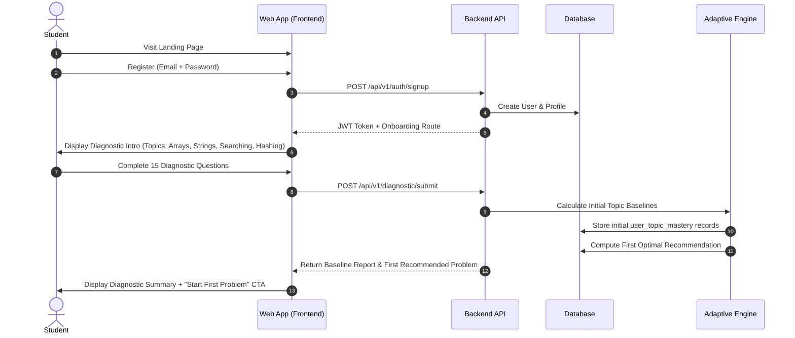
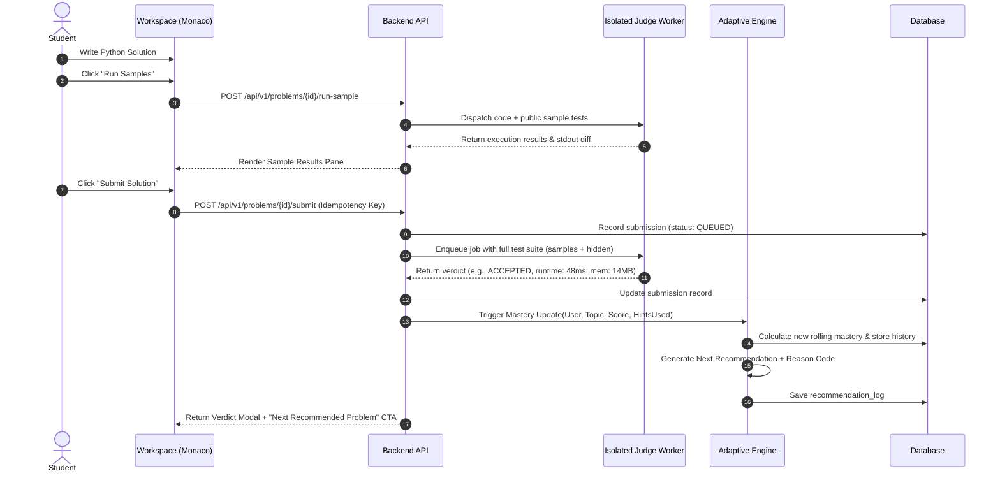
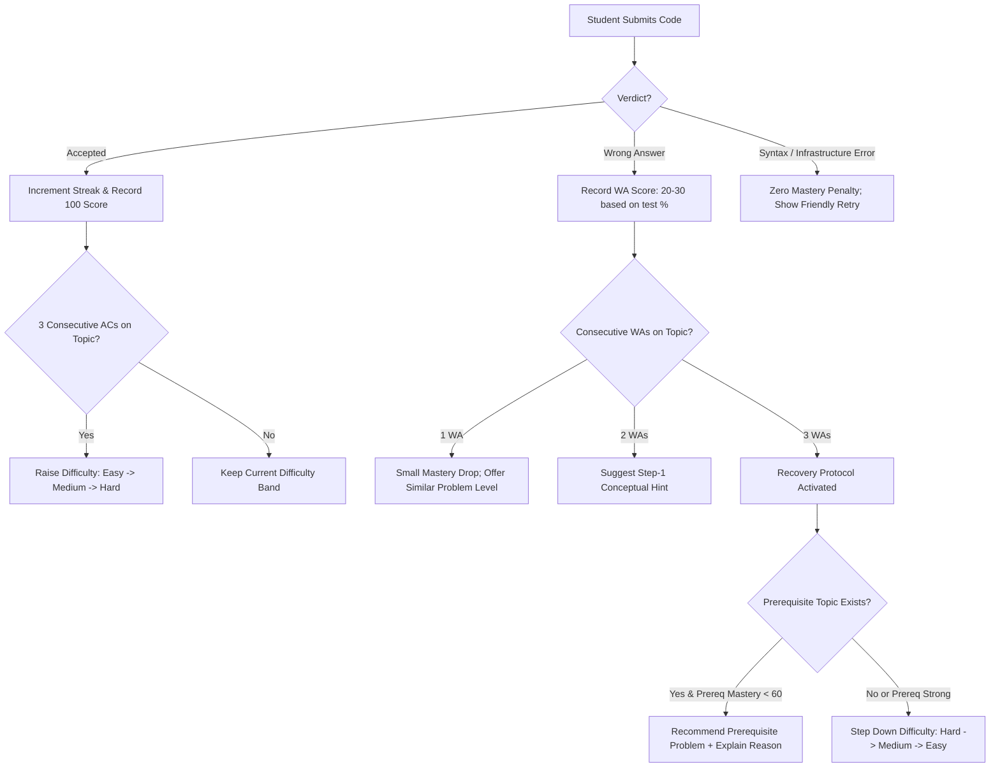

# CodeAdapt AI — Product Requirements Document (PRD v1.0 Detailed)

**Document Status:** Production Ready / MVP Specification  
**Product Tagline:** *"Every student gets the right problem at the right time."*  
**Core Loop:** `Assess → Practice → Evaluate → Update Mastery → Recommend → Repeat`

---

## 1. Executive Summary & Purpose

CodeAdapt AI is an intelligent, adaptive Data Structures and Algorithms (DSA) learning platform designed to eliminate learning plateaus, frustration, and tutorial hell for computer science students and job seekers. Unlike static problem banks (e.g., LeetCode, HackerRank) where learners randomly guess what to solve next, CodeAdapt continuously tracks topic-specific mastery and dynamically computes the optimal next problem with transparent educational reasoning.

This document serves as the single source of truth for product scope, personas, detailed epics, user stories, acceptance criteria, screen wireframes, adaptive decision logic, and metrics framework.

---

## 2. Personas & Core Needs

| Persona | Profile & Context | Primary Pain Point | Core Need | Target Success Outcome |
| :--- | :--- | :--- | :--- | :--- |
| **A — Beginner ("Riya")** | 1st/2nd year CS student; basic syntax knowledge, near zero DSA problem-solving intuition. | Overwhelmed by LeetCode Easy problems; freezes on edge cases and indexing. | Bite-sized problems, scaffolded hints, prerequisite revision. | Solves her first problem in session 1, experiences a confidence boost, and returns within 48h. |
| **B — Intermediate ("Arjun")** | 3rd/4th year student; knows concepts (Arrays, HashMaps) but struggles to identify which pattern applies. | "I know the theory but can't solve unseen problems"; gets stuck in medium-difficulty plateaus. | Systematic gap detection, spotting weak sub-patterns, structured progression. | Sees weak topic mastery improve from <40% to 70%+ over 2–3 weeks of targeted practice. |
| **C — Advanced ("Meera")** | Final year / working professional preparing for top-tier product company interviews. | Wasting time on trivial easy problems or repetitive patterns. | High-efficiency coverage, rapid progression to hard/composite problems. | Reaches medium/hard edge-case-heavy problems quickly without redundant repetition. |

> *Note on Scope:* Instructors, university administration dashboards, and coaching center cohorts are strictly **Post-MVP**.

---

## 3. Epics, User Stories & Acceptance Criteria

### Epic 1 — Authentication & Profile Management (FR-01) · P0
- **US-1.1:** *As a new student, I want to sign up with email/password so that my learning progress and mastery history are persistently saved.*
  - **AC-1.1.1:** Given a valid, unregistered email and strong password (≥8 chars, 1 number, 1 special character), when submitted, an account is provisioned, a JWT/session is issued, and user is redirected to `/onboarding`.
  - **AC-1.1.2:** Given an existing email, returns clean HTTP 409 error with accessible toast: "Email already registered. Please log in."
- **US-1.2:** *As a returning student, I want to securely log in and log out.*
  - **AC-1.2.1:** Given invalid credentials, returns generic HTTP 401 message ("Invalid email or password") to mitigate user enumeration attacks.
  - **AC-1.2.2:** Protected routes redirect unauthorized access to `/login` with `returnUrl` query parameter.
- **US-1.3:** *As a student, I want to view and edit my profile preferences.*
  - **AC-1.3.1:** Display name and target career goals can be modified. Preferred language defaults to `Python 3.11+` for MVP.
- **US-1.4:** *As a student, I want complete privacy over my code submissions.*
  - **AC-1.4.1:** Any API request requesting another user's submissions or telemetry returns HTTP 403 Forbidden and logs security audit event.

### Epic 2 — Onboarding & Diagnostic Assessment (FR-02, FR-03) · P0
- **US-2.1:** *As a new student, I want a concise onboarding flow explaining the diagnostic process.*
  - **AC-2.1.1:** Explains that the diagnostic consists of ~12–15 conceptual and algorithmic questions across core topics taking ~15 minutes.
  - **AC-2.1.2:** Clarifies that results establish an initial baseline estimate and adjust dynamically.
- **US-2.2:** *As a student, I want to take a multi-topic diagnostic test.*
  - **AC-2.2.1:** Questions cover: **Arrays, Strings, Searching, Hashing**.
  - **AC-2.2.2:** Progress bar displays question counter (`Question X of N`), estimated time remaining, and topic tag.
- **US-2.3:** *As a student, I want crash resilience during diagnostic.*
  - **AC-2.3.1:** Assessment state is cached client-side in `localStorage` and periodically synced via API (`/diagnostic/save-progress`).
  - **AC-2.3.2:** If browser closes, user is prompted with "Resume diagnostic" or "Restart diagnostic". Restart resets attempt safely without orphan records.
- **US-2.4:** *As a student, I want to view my initial topic mastery report.*
  - **AC-2.4.1:** Displays numeric score (0–100) and category label per topic: *Foundational (<40)*, *Developing (40–74)*, *Confident (75–100)*.
  - **AC-2.4.2:** Topics with insufficient diagnostic samples are explicitly marked as `Provisional (Low Confidence)`.

### Epic 3 — Problem Bank & Catalog Exploration (FR-04) · P0
- **US-3.1:** *As a student, I want to browse and filter the problem catalog.*
  - **AC-3.1.1:** Multi-facet filtering by: **Topic**, **Difficulty** (Easy, Medium, Hard), and **User Status** (Unseen, Attempted, Solved, Needs Revision).
  - **AC-3.1.2:** Each problem card displays Title, Topic Badge, Difficulty Badge, Estimated Completion Time (e.g. `~15 mins`), Acceptance Rate, and user state.
- **US-3.2:** *As a student, I want clean problem descriptions without leaked test data.*
  - **AC-3.2.1:** Statement view includes markdown statement, formatted sample Input/Output examples with explanations, and operational constraints.
  - **AC-3.2.2:** Hidden verification test cases and reference solutions are **never** delivered over the client API payload.
- **US-3.3:** *As a platform administrator, I want automated validation for published problems.*
  - **AC-3.3.1:** Content cannot be set to `published = true` unless its bundled reference Python solution passes 100% of public and hidden test cases under resource limits (≤2.0s CPU time, ≤64MB RAM).

### Epic 4 — In-Browser Coding Workspace (FR-05, FR-06) · P0
- **US-4.1:** *As a student, I want a full-featured code editor with syntax highlighting and pre-filled starter code.*
  - **AC-4.1.1:** Monaco Editor / CodeMirror embedded with Python syntax highlighting, automatic indentation, matching bracket closure, and dark mode theme.
  - **AC-4.1.2:** "Reset Starter Code" button with confirmation modal.
- **US-4.2:** *As a student, I want to run code against sample tests with instant output.*
  - **AC-4.2.1:** Clicking "Run Samples" executes the code against sample test cases in an isolated sandbox.
  - **AC-4.2.2:** Output viewer displays: Status (Passed/Failed), Execution Time, Standard Output, Expected Output, and Actual Output Diff.
- **US-4.3:** *As a student, I want to submit code for comprehensive test verification.*
  - **AC-4.3.1:** States transition visually: `Queued → Executing → Evaluated`.
  - **AC-4.3.2:** Verdicts handled: `Accepted (AC)`, `Wrong Answer (WA)`, `Time Limit Exceeded (TLE)`, `Memory Limit Exceeded (MLE)`, `Runtime Error (RTE)`, `Syntax/Compilation Error`.
  - **AC-4.3.3:** Wrong Answer reports `Passed X of Y test cases` without disclosing hidden input payloads.
- **US-4.4:** *As a student, I want transparent feedback when the judge system encounters infrastructure faults.*
  - **AC-4.4.1:** Sandbox timeout or 503 Internal Error surfaces: *"Judge infrastructure is temporarily busy. This attempt was not counted against your mastery."* with a one-click Retry button.
- **US-4.5:** *As a mobile user, I want an adaptive responsive workspace.*
  - **AC-4.5.1:** Mobile viewport (<768px) replaces the side-by-side desktop split pane with a tabbed interface: `[Problem | Code Editor | Test Results]`.

### Epic 5 — Attempt Logging & History (FR-07) · P0
- **US-5.1:** *As a student, I want to review my submission history.*
  - **AC-5.1.1:** Submissions tab lists timestamp, verdict, execution time, memory, and hints used. Clicking an attempt restores the exact submitted code in read-only mode with diff viewer.
- **US-5.2:** *As a system, I want submission requests to be strictly idempotent.*
  - **AC-5.2.1:** Double clicking "Submit" within 5 seconds utilizes a client-generated UUID `Idempotency-Key` preventing duplicate executions and duplicated database attempts.

### Epic 6 — Adaptive Recommendation Engine & Mastery Tracking (FR-08, FR-09) · P0
- **US-6.1:** *As a student, I want a single, mathematically sound next recommendation on my dashboard and post-submission screen.*
  - **AC-6.1.1:** Next recommendation displays Problem Name, Topic, Difficulty, and an explicit **"Why this problem?"** transparent explanation.
- **US-6.2:** *As a struggling student, I want automatic recovery interventions.*
  - **AC-6.2.1:** Two consecutive Wrong Answers on Topic $T$ prompt a structured hint suggestion.
  - **AC-6.2.2:** Three consecutive Wrong Answers trigger a fallback to an easier problem or a prerequisite foundation problem.
- **US-6.3:** *As a progressing student, I want difficulty to step up appropriately.*
  - **AC-6.3.1:** Three consecutive Accepted submissions on Topic $T$ at difficulty $D$ elevate recommendation to difficulty $D+1$.
- **US-6.4:** *As a student, I want to avoid repetitive solved problems.*
  - **AC-6.4.1:** Problems marked as `Solved` are excluded from standard recommendations unless scheduled in the spaced-repetition revision queue.
- **US-6.5:** *As a student, I want smooth, decay-resistant mastery calculation.*
  - **AC-6.5.1:** Uses exponentially weighted rolling average ($\alpha = 0.20$). Single errors do not excessively punish overall mastery.
  - **AC-6.5.2:** Syntax errors and system runtime errors cause **zero** mastery changes.

### Epic 7 — Analytics Dashboard & Mastery Visualization (FR-10) · P0
- **US-7.1:** *As a student, I want a consolidated dashboard.*
  - **AC-7.1.1:** Metrics row: Problems Solved, Total Attempted, Global Acceptance Rate with explicit denominator (e.g. `12 / 30 submissions (40%)`).
  - **AC-7.1.2:** Topic Mastery radar / horizontal bar chart with current mastery score (0–100) and progression velocity.
  - **AC-7.1.3:** "Needs Immediate Revision" section highlighting decaying or struggled concepts.
  - **AC-7.1.4:** High contrast, WCAG 2.1 AA compliant color coding paired with semantic icons and text.

### Epic 8 — Progressive Hints & Explanations (FR-11) · P1
- **US-8.1:** *As a student, I want layered hints so I can get unstuck without reading full answers.*
  - **AC-8.1.1:** 3 tiers of hints: Hint 1 (Conceptual intuition / high-level invariant), Hint 2 (Data structure & algorithmic pattern), Hint 3 (Pseudocode / edge case walkthrough).
  - **AC-8.1.2:** Revealing hints updates attempt metadata and slightly reduces the mastery increment weight for that attempt.
- **US-8.2:** *As a student, I want post-solution AI analysis.*
  - **AC-8.2.1:** Optional "Explain Alternative Approaches" button provides Big-O time/space trade-offs and Pythonic idioms. Clearly marked as AI assistance.

### Epic 9 — Revision Queue & Micro-Gamification (FR-12) · P1
- **US-9.1:** *As a student, I want an automated spaced-repetition revision queue.*
  - **AC-9.1.1:** Solved problems enter revision queue at intervals (Day 3, Day 7, Day 21).
- **US-9.2:** *As a student, I want genuine streak tracking.*
  - **AC-9.2.1:** Streaks increment only when at least 1 valid code attempt is submitted in a 24-hour UTC window. Streaks never gate access to learning features.

---

## 4. Key User Workflows

### Flow 1: First-Time User Activation


### Flow 2: Core Solve & Evaluation Loop


### Flow 3: Adaptive Recovery Branch (Three Consecutive WA)


---

## 5. UI/UX Wireframes & Component Layouts

### 5.1 Landing Page
```
+-----------------------------------------------------------------------------------+
|  [Logo] CodeAdapt AI                 Features   Curriculum   About    [Log in] [Sign Up] |
+-----------------------------------------------------------------------------------+
|                                                                                   |
|           Every student gets the right problem at the right time.                 |
|                                                                                   |
|    Stop getting stuck on random questions. CodeAdapt dynamically diagnoses your    |
|    weak spots, adapts problem difficulty in real time, and mentors your DSA path.   |
|                                                                                   |
|                 [ Start Free Diagnostic (15 Min) -> ]                             |
|                                                                                   |
+-----------------------------------------------------------------------------------+
|   [ 1. Assess ]                    [ 2. Practice ]              [ 3. Level Up ]   |
|   Pinpoint real strengths &        In-browser Python IDE        Continuous mastery|
|   gaps across 4 core topics        with instant test feedback   updates & curated |
|                                                                 next problems     |
+-----------------------------------------------------------------------------------+
|  System Status: Operational · Privacy Policy · Terms of Service · GitHub Repo      |
+-----------------------------------------------------------------------------------+
```

### 5.2 Workspace Screen (Split Pane - Desktop)
```
+-----------------------------------------------------------------------------------+
| [< Back to Dashboard]   Two Sum  [Easy] [Topic: Hashing]         [Hint 0/3] [Timer] |
+------------------------------------------+----------------------------------------+
| [Problem Statement] [Submissions] [Hints]| [Python 3.11]              [Reset Code]|
|                                          | def two_sum(nums: list[int],           |
| Given an array of integers `nums` and    |             target: int) -> list[int]: |
| an integer `target`, return indices of   |     # Your adaptive solution here      |
| the two numbers such that they add up    |     seen = {}                          |
| to target.                               |     for i, num in enumerate(nums):     |
|                                          |         diff = target - num            |
| Example 1:                               |         if diff in seen:               |
| Input: nums = [2,7,11,15], target = 9    |             return [seen[diff], i]     |
| Output: [0,1]                            |         seen[num] = i                  |
| Explanation: nums[0] + nums[1] == 9.     |     return []                          |
|                                          +----------------------------------------+
| Constraints:                             | [ > Run Samples ]   [ Submit Solution ]|
| - 2 <= nums.length <= 10^4               +----------------------------------------+
| - -10^9 <= nums[i] <= 10^9               | Output Console:                        |
|                                          | ✔ Sample Test 1 Passed (12ms)          |
|                                          | ✔ Sample Test 2 Passed (15ms)          |
+------------------------------------------+----------------------------------------+
```

### 5.3 Mobile Workspace Layout (<768px Viewport)
```
+---------------------------------------------+
| [<] Two Sum  [Easy] [Hashing]     [Hints]   |
+---------------------------------------------+
| [ (•) Statement ] [ ( ) Code ] [ ( ) Tests ]|
+---------------------------------------------+
| Given an array of integers `nums` and an    |
| integer `target`, return indices...         |
|                                             |
| Example 1: [2,7,11,15] -> [0,1]             |
|                                             |
| [ Switch to Code Editor -> ]                |
+---------------------------------------------+
| Fixed Bottom Bar: [Run Samples] [ Submit ]  |
+---------------------------------------------+
```

---

## 6. Comprehensive Screen States Specification

| Screen | Loading State | Empty State | Error State | Success State | Partial / Degraded State |
| :--- | :--- | :--- | :--- | :--- | :--- |
| **Dashboard** | Animated skeleton pulse cards for stats & recommendation box. | "Welcome! Complete your diagnostic to unlock personalized problems." | "Failed to fetch dashboard data. [Retry Button]" | Full analytics, topic radar, next problem with active CTA. | Shows mastery bars; topics with <3 attempts marked as `Provisional`. |
| **Workspace** | Skeleton editor placeholder while problem markdown loads. | N/A (Redirects to catalog if problem ID not found). | "Unable to connect to coding environment. [Reconnect]" | Interactive Monaco editor with starter code & passing sample tests. | Code runs in editor, but submission judge queue has elevated latency (>5s warning). |
| **Submission** | Spinner modal: "Executing test suite (7/12 completed)..." | N/A | "Judge service unreachable. Your code was saved. No score penalty applied. [Retry]" | Green checkmark, runtime percentile, memory stats, "Next Recommended" CTA. | Wrong Answer: displays passed count (e.g. 8/12) without leaking secret test cases. |
| **Catalog** | 8 skeleton problem cards pulsing in grid. | "No problems match your selected filters. [Clear Filters]" | "Failed to load problem library. [Retry]" | Paginated table with topic badges, difficulty tags, and solve status. | Filtered results returned with warning if pagination service is slow. |

---

## 7. Adaptive Engine Mathematical Model & Rule Specifications

### 7.1 Rolling Exponential Update Formula
Mastery for a given topic $T$ is represented on a continuous scale $[0, 100]$. Following each evaluated submission on topic $T$:

$$M_{new} = (1 - \alpha) \cdot M_{current} + \alpha \cdot S_{attempt}$$

Where:
- $M_{current}$: Current mastery rating $[0, 100]$.
- $\alpha$: Learning rate coefficient (Default: **0.20**; allows meaningful progress without drastic swings).
- $S_{attempt}$: Attempt Performance Score $[0, 100]$, calculated as:

$$S_{attempt} = \text{BaseScore}(\text{Verdict}) \times \text{DifficultyMultiplier} \times \text{HintPenalty}$$

#### Multiplier Coefficients:
1. **Base Verdict Score:**
   - `Accepted (AC)` = **100**
   - `Wrong Answer (WA)` with partial passes = $\max(20, \frac{\text{Passed Tests}}{\text{Total Tests}} \times 60)$
   - `Time Limit Exceeded (TLE)` / `Memory Limit (MLE)` = **30**
   - `Runtime Error (RTE)` = **20**
   - `Syntax / Compilation Error` = **$M_{current}$ (No change, $\Delta M = 0$)**
   - `Infrastructure Timeout (503)` = **$M_{current}$ (No change, $\Delta M = 0$)**
2. **Difficulty Multiplier:**
   - Easy Problem: $0.85$ (if $M_{current} > 70$), otherwise $1.0$
   - Medium Problem: $1.00$
   - Hard Problem: $1.20$ (capped at 100 total score)
3. **Hint Penalty Multiplier:**
   - 0 Hints Used: $1.00$
   - 1 Hint Used: $0.90$
   - 2 Hints Used: $0.75$
   - 3 Hints (Full Pseudocode) Used: $0.55$

### 7.2 Decision Matrix & Transparent Reason Codes

| Rule ID | Trigger Condition | Recommended Action | Reason Code | User-Facing Explanation |
| :--- | :--- | :--- | :--- | :--- |
| **REC-01** | Post-Diagnostic Initial Recommendation | Select lowest mastery topic problem with `Difficulty = Easy` | `INIT_BASELINE` | *"Based on your diagnostic baseline, let's solidify fundamentals in this topic."* |
| **REC-02** | 3 Consecutive Accepted on Topic $T$ at Difficulty $D$ | Recommend Topic $T$ at Difficulty $D+1$ | `STREAK_PROMOTION` | *"You crushed 3 consecutive problems here! Time to step up the challenge."* |
| **REC-03** | 1 Wrong Answer after high mastery ($M \ge 60$) | Recommend equivalent difficulty problem on Topic $T$ | `CONSOLIDATE_LEVEL` | *"Close attempt! Let's reinforce this concept with another problem at this level."* |
| **REC-04** | 3 Consecutive Failed Submissions on Topic $T$ | If prerequisite topic $P$ has $M_P < 60$, recommend $P$; else recommend Easy problem in $T$ | `PREREQ_RECOVERY` | *"You've hit a tricky hurdle. Let's revisit foundational concepts to make this click."* |
| **REC-05** | Topic $T$ has $M_T \ge 75$ and unseen catalog empty | Recommend next topic in curriculum sequence | `TOPIC_ADVANCE` | *"You have demonstrated strong mastery in this topic. Moving to next curriculum stage."* |
| **REC-06** | Problem solved >7 days ago and due in spaced repetition | Inject problem into dashboard revision queue | `SPACED_REVISION` | *"It's been a week since you solved this. A quick refresh locks it into long-term memory."* |
| **REC-07** | All problems in topic solved and no revision due | Honest catalog fallback | `CATALOG_EXHAUSTED` | *"You've solved all current problems in this topic! More problems are being authored."* |

---

## 8. Telemetry & Server-Side Event Tracking Plan

To prevent client spoofing and maintain reliable metrics, critical learning and execution events are published directly from backend application services.

```
+-----------------------------------------------------------------------------------------------+
| Event Name             | Trigger Location      | Required Payload Properties                  |
+------------------------+-----------------------+----------------------------------------------+
| signup_completed       | Auth Service (POST)   | { user_id, auth_provider, timestamp }        |
| onboarding_completed   | User Service          | { user_id, selected_language }               |
| diagnostic_started     | Assessment Service    | { user_id, assessment_id, started_at }       |
| diagnostic_completed   | Assessment Service    | { user_id, assessment_id, score_summary }    |
| recommendation_shown   | Recommendation Engine | { user_id, problem_id, reason_code, topic }  |
| recommendation_opened  | Problem Controller    | { user_id, problem_id, source: "rec_card" }  |
| sample_run_executed    | Judge Service         | { user_id, problem_id, passed_samples, ms }  |
| submission_dispatched  | Submission Service    | { user_id, submission_id, problem_id, uuid } |
| submission_evaluated   | Judge Worker Callback | { submission_id, verdict, runtime_ms, tests }|
| hint_revealed          | Hint Controller       | { user_id, problem_id, hint_tier: 1..3 }     |
| mastery_recalculated   | Adaptive Engine       | { user_id, topic_id, old_m, new_m, alpha }   |
| judge_infra_error      | Judge Worker Error    | { error_type, request_id, node_id, retry }   |
+-----------------------------------------------------------------------------------------------+
```

---

## 9. Launch Scope & Content Catalog Requirements

For MVP / Pilot readiness, the platform launches with the following vetted content:

1. **Core Curriculum Topics:**
   - `Arrays` (Prefix sums, two pointers, frequency counts)
   - `Strings` (Two-pointer palindrome, anagram checks, window basics)
   - `Searching` (Binary search fundamentals, boundary condition search)
   - `Hashing` (Hash map lookups, hash sets for duplicate detection)
2. **Problem Inventory:**
   - Minimum **10 problems per topic** (4 Easy, 4 Medium, 2 Hard) = **40 total problems**.
   - Each problem must include:
     - 2–3 public sample test cases with explicit explanations.
     - 10–15 hidden test cases including extreme boundary conditions ($N=0$, $N=1$, negative integers, maximum constraints).
     - Verified Python reference solution passing within 1.0 second.
     - 3-tier progressive hints.
3. **Diagnostic Assessment Bank:**
   - 24 validated conceptual & pseudo-code questions (6 per topic).
   - Each diagnostic randomly draws 3 questions per topic (12 total questions per diagnostic session).
