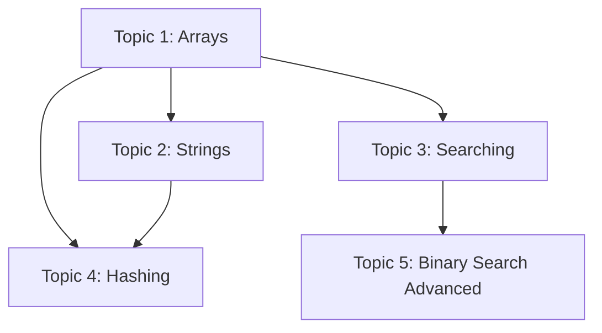

# CodeAdapt AI — Technical Requirements Document (TRD v1.0)

**Document Status:** Architecture & Technical Blueprint  
**System Type:** Full-Stack Adaptive EdTech Platform with Isolated Code Execution Sandbox  
**Target Architecture:** Microservices-Ready Modular Monolith / Decoupled Worker Architecture  

---

## 1. System Architecture Overview

CodeAdapt AI follows a decoupled, resilient architecture designed to guarantee sub-500ms API response times while safely handling untrusted Python code execution in isolated containers.

```
                              [ Client Browser ]
                         (Next.js App Router / React)
                                     │
                               HTTPS │ JWT / WSS
                                     ▼
                       [ Reverse Proxy / API Gateway ]
                         (Rate Limiting & CORS Guard)
                                     │
                     ┌───────────────┴───────────────┐
                     ▼                               ▼
          [ Core Application API ]         [ Auth & Identity ]
        (Node.js / Express or FastAPI)     (JWT / OAuth Provider)
                     │
         ┌───────────┼───────────┬──────────────┐
         ▼           ▼           ▼              ▼
    [(PostgreSQL)] [(Redis)] [Event Bus] [Adaptive Engine Service]
      Data Store     Cache    (BullMQ /    (Mastery Math & Next
                     & Queue   Redis)       Problem Selector)
                                 │
                                 ▼
                     [ Judge Sandbox Workers ]
                   (Docker / nsjail / Judge0)
                   - CPU / RAM / Time Capped
                   - Zero Network Egress
```

### Component Breakdown
1. **Frontend Web Client:** Next.js 14+ / React with TypeScript, Tailwind CSS, and Monaco Editor. Single-Page Application (SPA) feel with Server-Side Rendering (SSR) for static landing/catalog pages and Client-Side Rendering (CSR) for the interactive coding workspace.
2. **Core Backend API:** High-throughput REST API with structured middleware (authentication, validation with Zod/Pydantic, rate-limiting, and error handling).
3. **Adaptive Engine (Core Domain Service):** Autonomous domain logic module executing exponential mastery rolling updates, topic prerequisite graph traversals, and recommendation heuristic generation.
4. **Asynchronous Execution Queue (BullMQ / Redis):** Decouples code submission requests from synchronous HTTP threads, queuing compilation and execution jobs.
5. **Code Execution Sandbox (Judge0 / nsjail / Containerized Worker):** Ephemeral execution environment isolated with Linux `cgroups`, `namespaces`, `seccomp`, strict memory limits (64MB), and process timeouts (2.0s).
6. **Relational Database (PostgreSQL 15+):** ACID-compliant persistent store for users, profiles, problems, hidden tests, attempts, mastery history, and audit logs.

---

## 2. Technology Stack & Rationale

| Layer | Chosen Technology | Version / Spec | Technical Rationale |
| :--- | :--- | :--- | :--- |
| **Frontend Framework** | **Next.js / React** | Next.js 14+ / React 18+ | First-class SSR/SSG for SEO landing pages; App Router for nested client layouts; robust ecosystem. |
| **Styling & Design System** | **Tailwind CSS + Lucide Icons** | Tailwind v3.4+ | Utility-first CSS ensuring strict WCAG 2.1 contrast tokens, zero runtime CSS overhead, and dark mode. |
| **Code Editor** | **Monaco Editor (@monaco-editor/react)** | v4.6+ | The industry-standard VS Code engine in the browser; provides Python syntax highlighting, bracket matching, and auto-indent. |
| **Backend Runtime** | **Node.js (TypeScript) or Python (FastAPI)** | Node.js 20 LTS / Python 3.11 | High async I/O throughput; strong typing via TypeScript/Pydantic; seamless BullMQ integration. |
| **Database** | **PostgreSQL** | v15 / v16 | Strong relational integrity, JSONB support for test cases/results, ACID transactions for submission records. |
| **Cache & Message Broker** | **Redis** | v7.x | Sub-millisecond session and problem metadata caching; reliable job queue with BullMQ. |
| **Code Execution Engine** | **Judge0 CE / nsjail Docker Sandbox** | Latest stable | Secure sandbox using Linux namespaces, cgroups, and seccomp filters preventing fork bombs and file-system escape. |
| **Data Validation** | **Zod / Pydantic** | Latest | Strict runtime schema validation across API ingress and database boundaries. |

---

## 3. Non-Functional Requirements (NFRs)

### 3.1 Performance & Latency Targets
- **Catalog & Dashboard Endpoints (p95):** $\le 250\text{ ms}$ (Redis-cached query responses).
- **Run Sample Test Execution:** $\le 1.8\text{ s}$ total turnaround (including sandbox warm-start).
- **Full Submission Evaluation (p95):** $\le 3.5\text{ s}$ for standard 15-test-case suites.
- **Client Bundle Size:** First Contentful Paint (FCP) $\le 1.2\text{ s}$ on 4G simulated networks. Monaco Editor lazily loaded only on `/problems/[id]` route.

### 3.2 Security & Sandbox Isolation
- **No Network Access (Egress/Ingress):** Sandbox worker containers run with `--net=none`. Zero external HTTP requests permitted from student code.
- **Resource Constraints (Rlimits):**
  - CPU Wall Time Limit: `2.0 seconds`
  - Max Memory Allocation: `64 MB`
  - Max Output Stream (Stdout/Stderr): `256 KB` (prevents memory exhaustion attacks via infinite print loops)
  - Process Limit (PID limit): `30` (prevents fork-bomb vulnerabilities)
- **Filesystem Security:** Mount root filesystem as read-only (`ro`); temporary scratch directory mounted with `noexec, nosuid, nodev` in RAM (`tmpfs`).
- **Data Protection:** Hidden test cases and reference code solutions are **never serialized** in client API responses. Only test case counts and failed test indices (without input/output content) are returned.
- **IDOR Protection:** Strict row-level authorization middleware verifies that `request.user.id == submission.user_id` on all attempt review queries.

### 3.3 Reliability & Idempotency
- **Submission Idempotency:** The client issues an `Idempotency-Key: UUIDv4` header on all `/submit` requests. The backend stores this key in Redis with a 15-second TTL. Duplicate requests during transit return the in-flight job ID or cached result.
- **Circuit Breaker on Judge Service:** If the execution sandbox returns $\ge 5$ consecutive 503/timeout responses within 60 seconds, the circuit breaker opens, immediately surfacing safe retry UI and preventing job queue congestion.

### 3.4 Accessibility (a11y)
- Full compliance with **WCAG 2.1 Level AA**:
  - Color contrast ratio $\ge 4.5:1$ for normal text, $\ge 3:1$ for large text and UI components.
  - Keyboard navigability for all interactive controls (skip-to-content, tab-focus traps for modals).
  - Status messages (e.g. "Running...", "Accepted", "Wrong Answer") announced to assistive tech via `aria-live="polite"` regions.

---

## 4. Code Execution Sandbox Pipeline Specification

### Pipeline Steps:
```
[Client Submits Code]
        │
        ▼
[1. AST Syntax Sanity Check] 
    - Fast static check in <10ms
    - Rejects syntax errors before touching sandbox queue
        │
        ▼
[2. Enqueue Job to BullMQ]
    - Priority queue: Sample runs (Priority 1) > Full submissions (Priority 2)
        │
        ▼
[3. Worker Pulls Job & Prepares Container]
    - Inject code & runner harness
    - Runner feeds stdin test case JSON line by line
        │
        ▼
[4. Isolated Execution under Rlimits]
    - Monitor execution wall time & memory RSS
        │
        ▼
[5. Evaluate Verdicts]
    - Compare stdout hash or trimmed string against expected output
    - Output classification: AC, WA, TLE, MLE, RTE
        │
        ▼
[6. Publish Result & Trigger Webhook / SSE]
    - Store submission results in DB
    - Trigger Adaptive Mastery update
```

### Sandbox Execution Command (Docker/nsjail template):
```bash
docker run --rm \
  --net=none \
  --memory=64m \
  --memory-swap=64m \
  --cpus=1.0 \
  --pids-limit=30 \
  --read-only \
  --tmpfs /tmp:rw,noexec,nosuid,size=16m \
  -v /runner/harness.py:/app/harness.py:ro \
  python:3.11-slim \
  python /app/harness.py
```

---

## 5. Adaptive Recommendation Engine Implementation Spec

### 5.1 Curriculum Prerequisite DAG (Directed Acyclic Graph)
The system models topic dependencies as a directed acyclic graph:



### 5.2 Recommendation Selection Heuristic Algorithm
When computing the next problem for `user_id`:

```typescript
interface RecommendationInput {
  userId: string;
  lastProblemId?: string;
  lastVerdict?: 'ACCEPTED' | 'WRONG_ANSWER' | 'SYNTAX_ERROR' | 'RTE' | 'TLE';
}

interface RecommendationResult {
  problemId: string;
  topicId: string;
  difficulty: 'EASY' | 'MEDIUM' | 'HARD';
  reasonCode: string;
  explanation: string;
}

// Algorithmic Decision Order:
// 1. Check for Spaced-Repetition Revision due (Interval >= 7 days, mastery >= 70).
// 2. Check for Recovery Condition (>= 3 consecutive failures on current topic):
//    - If Prerequisite topic mastery < 60: Recommend prerequisite Easy problem.
//    - Else: Step down difficulty on current topic.
// 3. Check for Promotion Condition (>= 3 consecutive ACs on current topic & difficulty):
//    - Step up difficulty (Easy -> Medium -> Hard).
// 4. Default: Select problem in lowest-mastery topic matching user's current mastery band:
//    - Mastery < 40: EASY problem
//    - Mastery 40-74: EASY or MEDIUM problem
//    - Mastery >= 75: MEDIUM or HARD problem
// 5. Anti-Repetition Filter:
//    - Exclude all previously solved problem IDs (unless in revision queue).
//    - Exclude problem attempted in last 2 sessions if not solved.
```

---

## 6. Real-Time Communication & Polling Strategy

For the MVP, CodeAdapt AI adopts **Optimistic REST Polling with Short Intervals (500ms)** for submission status checks, backed by Redis:
- Client receives `submission_id` with HTTP 202 Accepted.
- Client polls `GET /api/v1/submissions/{id}/status` every 500ms (max 10 retries / 5s timeout).
- Once status transitions from `QUEUED` | `RUNNING` to `COMPLETED`, backend delivers verdict payload and client stops polling.
- *Post-MVP migration path:* Server-Sent Events (SSE) or WebSockets if concurrent active judge load exceeds 5,000 learners.

---

## 7. Error Handling & Circuit Breaker Architecture

Standardized JSON error envelope across all REST APIs:

```json
{
  "success": false,
  "error": {
    "code": "RATE_LIMIT_EXCEEDED",
    "message": "Too many code executions. Please wait 10 seconds before submitting again.",
    "requestId": "req_01h8x9p3...",
    "details": {
      "retryAfterSeconds": 10
    }
  }
}
```

### Standard HTTP Status Map:
- `200 OK`: Request succeeded synchronously.
- `201 Created`: Entity (User, Problem, Attempt) provisioned.
- `202 Accepted`: Asynchronous job queued (Code execution).
- `400 Bad Request`: Validation failure (Malformed payload).
- `401 Unauthorized`: Missing or expired JWT token.
- `403 Forbidden`: IDOR protection breach (Attempting to view other user's data).
- `404 Not Found`: Entity does not exist.
- `409 Conflict`: Unique constraint violation (Email registered).
- `429 Too Many Requests`: Rate limit triggered (max 10 runs / min per user).
- `503 Service Unavailable`: Judge sandbox queue exhausted or circuit open.

---

## 8. Exhaustion-Proof Adaptive Question Bank Architecture

### 8.1 4-Tier Resolution Architecture

```
[Student Practice Loop / Next Problem Request]
                      │
                      ▼
 ┌─────────────────────────────────────────────────────────────┐
 │ Tier 1: Verified Database Question Catalog                  │
 │ - Queries unseen, unsolved, and revision-due questions      │
 │ - Filters by topic mastery band and difficulty              │
 └────────────────────────────┬────────────────────────────────┘
                              │
                    Found? ───┴─── Yes ──► [Deliver Tier 1 Problem]
                              │ No (Exhausted)
                              ▼
 ┌─────────────────────────────────────────────────────────────┐
 │ Tier 2: Parameterized Variation Generator                   │
 │ - Selected from validated semantic problem templates        │
 │ - Parameter mutations with controlled constraints           │
 │ - Runs isolated sandbox validation & duplicate detection    │
 └────────────────────────────┬────────────────────────────────┘
                              │
                    Valid? ───┴─── Yes ──► [Publish & Deliver Tier 2 Problem]
                              │ No / Insufficient
                              ▼
 ┌─────────────────────────────────────────────────────────────┐
 │ Tier 3: LLM & Synthetic Generation Pipeline                 │
 │ - Configurable provider (OpenAI / Anthropic / Gemini / etc.)│
 │ - Zero-Key Curriculum Synthesis fallback                    │
 │ - Runs isolated sandbox validation & duplicate detection    │
 └────────────────────────────┬────────────────────────────────┘
                              │
                    Valid? ───┴─── Yes ──► [Publish & Deliver Tier 3 Problem]
                              │ No / API Limit / Timeout
                              ▼
 ┌─────────────────────────────────────────────────────────────┐
 │ Tier 4: Fail-Safe Transparent Fallback                      │
 │ 1. Spaced-repetition revision on lowest mastery topic       │
 │ 2. Prerequisite topic foundational problem                 │
 │ 3. Transparent catalog-exhausted guidance & next steps      │
 └─────────────────────────────────────────────────────────────┘
```

### 8.2 Security, Duplication & Sandbox Verification Rules
1. **Never Show Unvalidated Content:** Problems remain in `DRAFT` or `VALIDATING` until all sample + hidden test cases pass the isolated runner with the reference solution.
2. **Duplicate & Near-Duplicate Rejection:** Token Jaccard threshold $\ge 0.68$, Levenshtein title threshold $\ge 0.80$, and variable/numeric masking to defeat trivial constant substitutions.
3. **Execution Safety:** Prohibits OS/system module access (`import os`, `import sys`, `eval`, `exec`), enforced timeouts ($2000$ms), and 64MB memory caps.
4. **Quota & Rate Limits:** Per-user window limits (5 generations/hour) and graceful degradation when no AI API key is configured.

