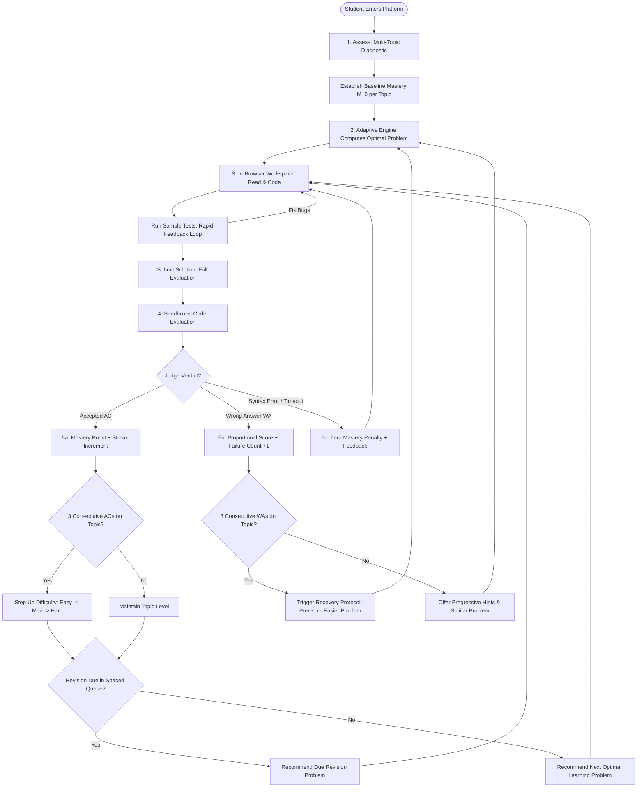
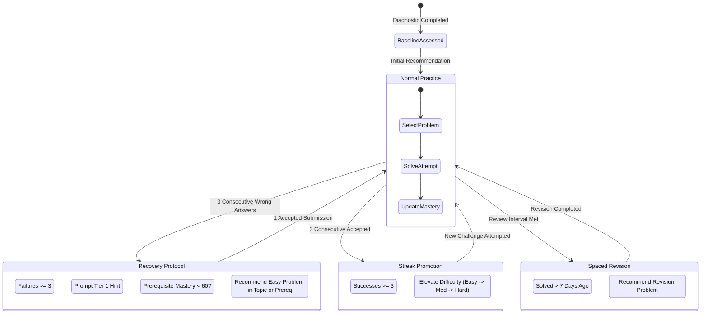

# CodeAdapt AI — End-to-End Workflow Specification

**Document Status:** Complete Operational & Architectural Workflow Guide  
**Location:** `brain/WORKFLOW.md`  
**Purpose:** Comprehensive visual diagrams, state machines, and step-by-step lifecycles for students, system workers, and the adaptive recommendation engine.

---

## 1. High-Level Master Workflow (Core Loop)

The CodeAdapt AI learning lifecycle operates on a continuous feedback loop:



---

## 2. Step-by-Step User Journey Workflows

### 2.1 First-Time Student Journey (The Activation Path)

```
[ Landing Page ]
      │
      ▼
[ Step 1: Onboarding Modal ]
  - Language: Python 3.11 (default)
  - Time commitment: ~15 minutes
  - Educational promise: "Results are an estimate and adapt continuously"
      │
      ▼
[ Step 2: Diagnostic Assessment ]
  - 12–15 conceptual & complexity questions across 4 core topics:
    * Arrays (memory layout, index lookups, prefix sums)
    * Strings (immutability, two-pointers, character frequencies)
    * Searching (monotonicity, binary search boundaries)
    * Hashing (hash maps, O(1) lookups, complement matching)
  - Auto-saved progress (browser crash resilience)
      │
      ▼
[ Step 3: Diagnostic Report ]
  - Topic-by-topic baseline report (0 to 100)
  - Labels: "Needs Foundation" (<40), "Developing" (40–74), "Confident" (75+)
      │
      ▼
[ Step 4: First Landing on Dashboard ]
  - First Recommended Problem highlighted with explicit reason:
    e.g. "Why: Based on your diagnostic baseline in Hashing, let's build O(1) intuition with Two Sum."
      │
      ▼
[ Step 5: First Solve Experience ]
```

---

### 2.2 In-Workspace Solving & Progressive Hint Workflow

When a student opens any problem (e.g., `/problems/p_two_sum`):

```mermaid
sequenceDiagram
    autonumber
    actor Student
    participant UI as Workspace UI (React)
    participant Monaco as Monaco Editor
    participant Runner as Python Runner / Judge
    participant Adaptive as Adaptive Engine

    Student->>UI: Reads Problem Statement & Constraints
    Student->>Monaco: Writes initial Python code
    
    rect rgb(20, 30, 50)
    Note over Student, Runner: Fast Local Feedback Loop
    Student->>UI: Clicks "Run Samples"
    UI->>Runner: Dispatch code against public sample tests
    Runner-->>UI: Output diff (Passed/Failed + expected vs actual)
    UI-->>Student: Display Output Console
    end

    opt Student Gets Stuck
        Student->>UI: Clicks "Adaptive Hints"
        UI->>Student: Reveal Tier 1: High-level Intuition (Penalty: 10%)
        Note right of Student: "Consider complement = target - num"
        opt Still Stuck
            Student->>UI: Reveal Tier 2: Algorithmic Pattern (Penalty: 25%)
            Note right of Student: "Use a Hash Map to store seen numbers"
        end
        opt Blocked Completely
            Student->>UI: Reveal Tier 3: Pseudocode Walkthrough (Penalty: 45%)
            Note right of Student: Step-by-step logic breakdown
        end
    end

    Student->>Monaco: Refines code
    Student->>UI: Clicks "Submit Solution" (with Idempotency UUID)
    UI->>Runner: Dispatch full test suite (samples + hidden edge cases)
    Runner-->>UI: Verdict: ACCEPTED / WRONG_ANSWER (runtime, memory, tests)
    
    UI->>Adaptive: Record attempt(verdict, testsPassed, totalTests, hintsUsed)
    Adaptive->>Adaptive: Calculate new rolling mastery M_new
    Adaptive->>Adaptive: Compute next optimal recommendation
    Adaptive-->>UI: Return mastery delta (+11) & next problem
    UI-->>Student: Display Modal with Confetti & "Next Problem" CTA
```



---

## 3. Adaptive Engine State Machine & Recovery Workflow

The engine continuously switches states based on learning telemetry:



---

## 4. Persona-Specific User Workflows

### Workflow A: Beginner Student ("Riya")
1. **Initial Diagnostic:** Scores 31 in Searching, 42 in Hashing, 65 in Arrays.
2. **First Recommendation:** `Find Maximum in Array` (Easy, Arrays) to build immediate confidence.
3. **Execution:** Solves in 6 minutes, gets `+8` mastery boost and confetti celebration.
4. **Adaptive Progression:** Next problem introduces `Valid Palindrome` (Two-pointer technique).
5. **If Stuck:** Uses Tier 1 hint; code passes; mastery formula factors in hint penalty without demotivating score drops.

### Workflow B: Intermediate Student ("Arjun")
1. **Initial Diagnostic:** Scores 65 in Arrays, 50 in Strings, 30 in Searching, 42 in Hashing.
2. **First Recommendation:** `Two Sum` (Hashing) to connect Array knowledge to Hash Tables.
3. **Recovery Branch Simulation:**
   - Arjun attempts `Binary Search in Rotated Array` and fails 3 times on edge cases.
   - **System Intervention:** Instead of letting him rage-quit, the engine intervenes:
     - Detects `consecutive_failures == 3`.
     - Checks prerequisite: Basic `Binary Search`.
     - Explains: *"You've hit a tricky hurdle with rotated arrays. Let's revisit standard Binary Search boundary conditions first."*
   - Arjun solves the foundation problem, regains momentum, and returns to the harder problem.

### Workflow C: Advanced Student ("Meera")
1. **Initial Diagnostic:** Scores 85+ across all core topics.
2. **Bypass Rules:** The engine automatically bypasses trivial single-pass easy questions.
3. **Direct Hard / Medium Delivery:** Recommends composite problems (`Search in Rotated Sorted Array`, `Group Anagrams`, `Subarray Sum Equals K`).
4. **Streak Promotion:** 3 consecutive ACs trigger composite topic challenges.

---

## 5. Technical Data & Execution Workflow

### Submission Evaluation Flow in the Sandbox:

```
[ 1. Web Client ]
  - User clicks Submit
  - Generates client-side UUID: Idempotency-Key
  - Sends POST /problems/:id/submit
         │
         ▼
[ 2. API Gateway & Ingress ]
  - Verifies JWT authorization
  - Checks Redis Idempotency cache (prevents double submits within 15s)
  - Performs instant AST static syntax validation (<10ms)
         │
         ▼
[ 3. Job Dispatch (BullMQ / Redis) ]
  - Enqueues job with priority (Sample run = Priority 1, Full submit = Priority 2)
         │
         ▼
[ 4. Sandboxed Worker Container ]
  - Linux namespaces, cgroups, seccomp active
  - Zero network egress (--net=none)
  - Memory limit: 64MB | CPU limit: 2.0s | PIDs limit: 30
  - Executes test suite harness against Python solution
         │
         ▼
[ 5. Evaluator & Aggregator ]
  - Captures stdout, stderr, execution wall-time, RSS memory
  - Classifies verdict: AC, WA, TLE, MLE, RTE
         │
         ▼
[ 6. Adaptive Mastery Service ]
  - Calculates rolling exponential update:
    M_new = (1 - 0.2) * M_old + 0.2 * AttemptScore
  - Updates PostgreSQL user_topic_mastery & mastery_history
  - Computes next optimal problem + reason code
         │
         ▼
[ 7. Response Delivery ]
  - Client receives verdict, telemetry, and next recommendation card
```

---

## 6. Verification Scenarios & Failure Handling Matrix

| Event / Failure | Immediate System Behavior | Student Impact | Mastery Impact |
| :--- | :--- | :--- | :--- |
| **Normal Accepted** | Full green modal, runtime/memory stats, confetti. | High motivation, next problem unlocked. | $+10\text{ to }+20$ points depending on prior score. |
| **Wrong Answer (Partial Pass)** | Amber modal showing passed tests count (e.g. 7/12). Hidden inputs obscured. | Encouraged to check edge cases or reveal hint. | Small drop ($-4\text{ to }-8$ points). |
| **Python Syntax Error** | Output console prints Python Traceback with line number. | Can immediately fix syntax in Monaco editor. | $\mathbf{\Delta M = 0}$ (Zero penalty). |
| **Sandbox Timeout / 503** | "Infrastructure is busy. Your attempt was saved. Click retry." | Friendly retry button, no frustration. | $\mathbf{\Delta M = 0}$ (Zero penalty). |
| **Catalog Exhaustion** | System informs student that all problems in topic are solved. | Pulls revision pick from spaced queue. | Preserves existing high mastery. |
